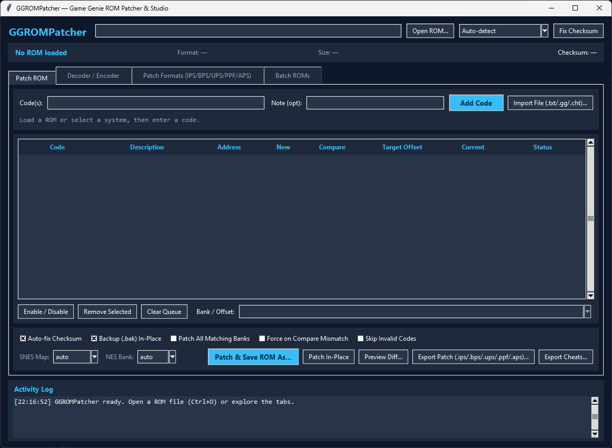
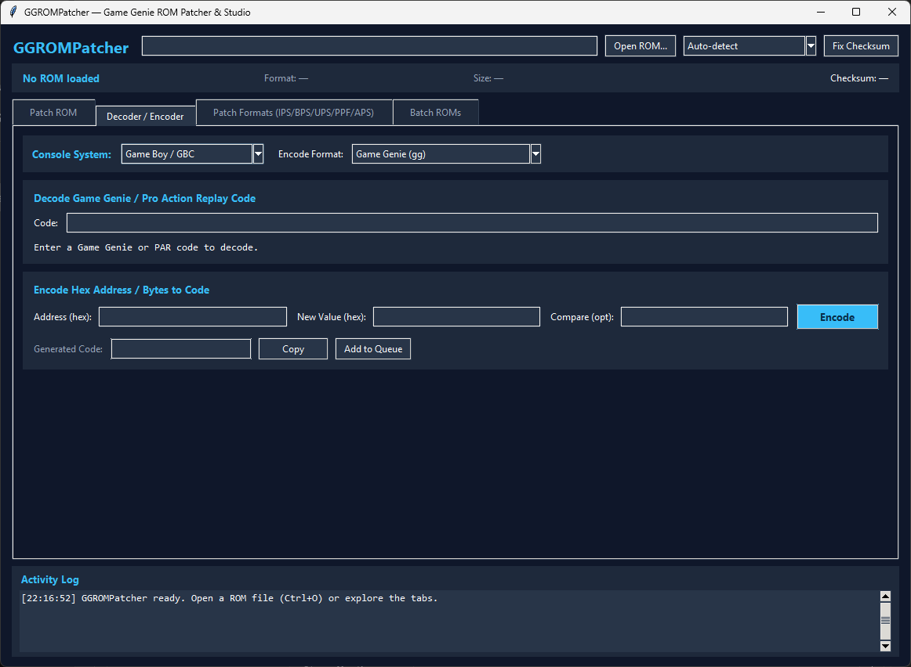
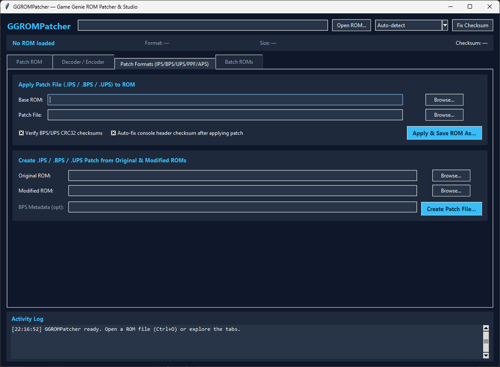
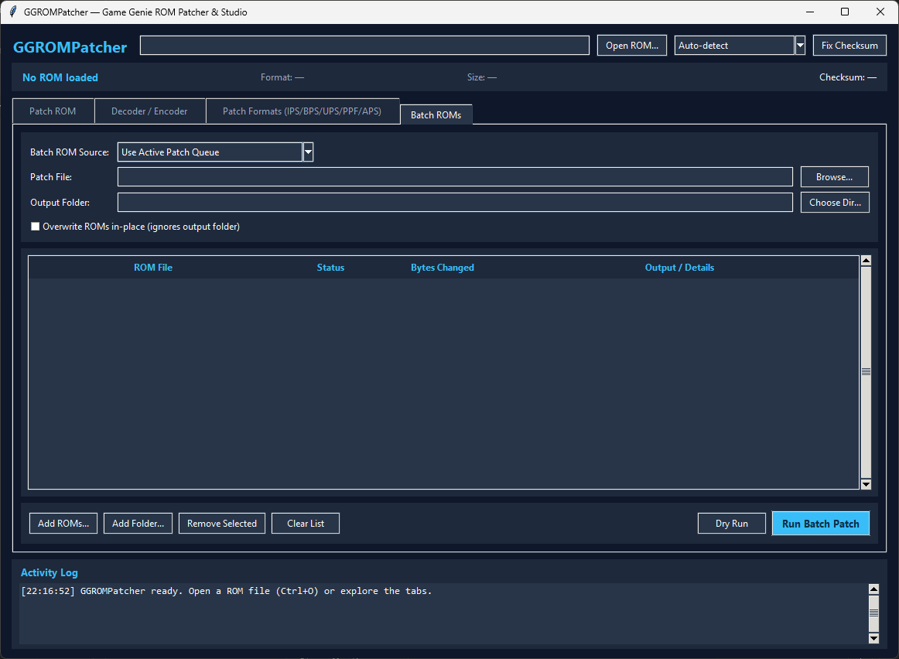

# GGROMPatcher

**GGROMPatcher** is a zero-dependency, cross-platform ROM patching suite featuring both a **Tkinter Desktop GUI** and a **CLI / Python library**. It detects ROM headers automatically, verifies ROM hashes against Logiqx/No-Intro XML DAT and JSON databases, scans banked ROMs for compare-byte matches, decodes/encodes Game Genie, Pro Action Replay/Rocky, and GameShark Advance codes, previews hex diffs before saving, applies patches to single ROMs or batches, recalculates console checksums, exports cheat lists (`.txt` / `.gg` / RetroArch `.cht`), and creates/applies `.ips`, `.bps`, `.ups`, `.ppf`, and `.aps` binary patches.

## Features

- **Multi-System Support**:
  - **Game Boy / Game Boy Color (`.gb`, `.gbc`, `.sgb`)**: 6- and 9-character Game Genie codes (`XXX-XXX`, `XXX-XXX-XXX`, or space/unhyphenated forms), 16 KB bank scanning across `$0000-$7FFF`, Nintendo logo validation, header checksum (`0x014D`) and global checksum (`0x014E-0x014F`) recalculation, and diagnostic GameShark / Action Replay RAM code detection.
  - **Game Boy Advance (`.gba`, `.agb`)**: 156-byte Nintendo boot logo and `0x96` fixed-byte detection, title / game code / maker code extraction, header complement checksum (`0xBD`) repair, **GameShark Advance v1/v2 ROM patch codes** (raw `6AAAAAAA 0000VVVV` and TEA-encrypted `GSA1:XXXXXXXX XXXXXXXX`), **Action Replay v3 4-word ROM patches** (`PAR3:...`), cartridge ROM bus patches (`PAR:08xxxxxx:VV[VV[VVVV]]` across Wait States `0x08`/`0x0A`/`0x0C`), and runtime RAM/CodeBreaker diagnostics (`EWRAM`/`IWRAM`/graphics/I/O).
  - **Sega Game Gear & Master System (`.gg`, `.sms`)**: 6- and 9-character Game Genie codes across `$0000-$BFFF` 16 KB slots, `TMR SEGA` header parsing (`0x7FF0`/`0x3FF0`/`0x1FF0`), little-endian BIOS checksum recalculation across all size codes (`$A`–`$2`), and Action Replay RAM diagnostics.
  - **NES / Famicom (`.nes`)**: 6- and 8-character Game Genie codes (`APZLGITYEOXUKSVN`), **8-hex Pro Action Rocky** codes + `PAR:` / `ROCKY:` CPU-ROM patches (`PAR:8010?03:FF`), iNES & NES 2.0 header parsing (with DiskDude guard and 512-byte trainer offset handling), mapper-aware `8k` / `16k` / `32k` PRG bank mapping and mirroring.
  - **Super Nintendo (`.sfc`, `.smc`, `.swc`, `.fig`)**: 8-character Game Genie codes (`XXXX-XXXX`), **`PAR:` / `AR:` ROM codes** (`PAR:008000:EA`, rejecting WRAM `$7E`/`$7F` addresses clearly), automatic 512-byte SMC copier header detection, scored LoROM / HiROM / ExHiROM / ExLoROM address mapping (with manual override), and power-of-2 mirrored ROM checksum + complement recalculation.
  - **Sega Genesis / Mega Drive (`.bin`, `.md`, `.gen`, `.smd`, `.68k`)**: 8-character 16-bit word Game Genie codes (`XXXX-XXXX`), **`PAR:` / `AR:` ROM codes** (`PAR:000338:6004` / 8-bit `PAR:000338:60`, rejecting 68000 RAM `$E00000-$FFFFFF`), plain binary and `.smd` Super Magic Drive interleaved container support (supporting both even-first and odd-first 16 KB interleaving conventions), and `0x018E` big-endian word checksum recalculation.
  - **Raw File Offset Patches**: Direct file-offset patches in `OFFSET:HEX`, `OFFSET?CMP:HEX`, `OFFSET=HEX`, or `OFFSET=CMP?HEX` notation.
- **ROM Hashing & Checksum/DAT Verification**: Computes CRC32, MD5, SHA-1, and SHA-256 digests (plus headerless digests with iNES 16B / SMC 512B / SMD 512B stripping) and matches ROMs against **Logiqx / No-Intro XML `.dat`** or **JSON** ROM databases (`ggrompatcher inspect --hashes --dat ...`).
- **Compare-Byte Bank Scanning & Disambiguation**: Automatically finds which ROM bank(s) hold the expected compare byte; prompts you to select a bank (`--bank` / GUI dropdown) or patch all matches (`--all-matches`) when multiple banks match, or override mismatches with `--force`.
- **Pre-Save Hex Diff Preview**: Inspect unified byte-level hex hunks (`ggrompatcher diff`, `ggrompatcher patch --preview-diff`, or **Preview Diff...** in the GUI) before writing a patched ROM.
- **Batch Cheat Parsing & Export**: Parses plain text lists, `.gg` files, RetroArch `.cht` files (`--enabled-only` supported), `+`-chained multi-part codes, space-separated triads, and `PAR:` / `ROCKY:` / `GSA:` / `PAR3:` codes — and exports cheat sheets back to `.txt`, `.gg`, or RetroArch `.cht`.
- **Binary Patch Formats (`.ips`, `.bps`, `.ups`, `.ppf`, `.aps`)**:
  - **IPS**: RLE compression, >64 KB chunk splitting, `0x454F46` EOF-offset collision avoidance, Lunar IPS post-EOF truncation.
  - **BPS (`BPS1`)**: Biased VLQ encoding, `SourceRead` / `TargetRead` / `SourceCopy` / `TargetCopy`, CRC32 verification, optional metadata header.
  - **UPS (`UPS1`)**: XOR-run delta blocks supporting both forward application and bidirectional reverse application with full source/target/patch CRC32 checks.
  - **PPF (`PPF10` / `PPF20` / `PPF30`)**: PlayStation Patch Format v1.0, v2.0 (size + 1024-byte blockcheck), and v3.0 (64-bit offsets, optional BIN/GI blockcheck, optional **reversible undo data**, and `FILE_ID.DIZ` trailer).
  - **APS (`APS10` & `APS1`)**: Supports **APS-N64 / Simple (`APS10`)** (with optional `.z64`/`.v64` CartID + CRC verification and RLE runs) and **APS-GBA (`APS1`)** (64 KiB XOR blocks with CRC-16/CCITT-FALSE verification).
- **Multi-ROM Batch Patching**: Apply cheat queues or `.ips`/`.bps`/`.ups`/`.ppf`/`.aps` patches across multiple ROMs or directories at once via `ggrompatcher batch-patch` or the **Batch ROMs** GUI tab (with `--dry-run`, `--out-dir`, and `--in-place` support).
- **Safe File Handling**: Writes `<name>.patched.<ext>` by default, creates `<name>.bak` backups for in-place edits, and offers `--dry-run` preview mode.

## Installation

Requires **Python 3.10+** (zero third-party runtime dependencies).

```bash
pip install .
```

Optional drag-and-drop support in the Desktop GUI (`tkinterdnd2`):

```bash
pip install -e ".[dnd]"
```

For editable/development installation with test, lint, and packaging tools:

```bash
pip install -e ".[dev]"
```

### Portable Zipapp & Standalone Builds

Build a self-contained single-file Python executable archive (`dist/ggrompatcher.pyz`) with no external dependencies:

```bash
python scripts/build_zipapp.py
python dist/ggrompatcher.pyz --help
```

Tagged releases (`v*`) also run automated GitHub Actions builds publishing Python wheels, `.pyz` zipapps, and PyInstaller binaries for Linux, Windows, and macOS.

### Desktop GUI (`tkinter`) Note

The GUI uses Python's standard-library `tkinter` (and optionally `tkinterdnd2` for OS drag-and-drop; if absent, drag-and-drop falls back gracefully without impacting any other feature). On some Linux distributions or Homebrew Python setups, `tkinter` is packaged separately:

- **Debian / Ubuntu**: `sudo apt-get install python3-tk`
- **Fedora / RHEL**: `sudo dnf install python3-tkinter`
- **macOS (Homebrew)**: `brew install python-tk`

If `tkinter` is unavailable, `ggrompatcher` CLI commands still work without it.

## Desktop GUI

Launch the desktop application via:

```bash
ggrompatcher gui
# or open a ROM immediately:
ggrompatcher gui path/to/game.gba
# or via the GUI entry point:
ggrompatcher-gui
```

Running `ggrompatcher` with no arguments also opens the GUI when a graphical display and `tkinter` are available (otherwise it prints CLI help).

### Screenshots

| Patch ROM | Decoder / Encoder |
| :---: | :---: |
|  |  |
| **Patch Formats (IPS / BPS / UPS / PPF / APS)** | **Batch ROMs** |
|  |  |

### GUI Tabs & Shortcuts

1. **Patch ROM**:
   - Load any ROM (`Ctrl+O`), inspect detected format/title/checksums, and queue single, `+`-chained, `PAR:`/`ROCKY:`, or GBA `6AAAAAAA 0000VVVV` codes or import `.txt`/`.gg`/`.cht` cheat files (`Ctrl+I`).
   - Live decode preview validates codes as you type and clearly reports RAM-only Action Replay / GameShark / CodeBreaker codes.
   - Select any queued row to toggle enabled state, inspect status (`READY`, `ALREADY PATCHED`, `CHOOSE BANK`, `MISMATCH`, `OUT OF RANGE`), or pin a specific bank/file offset from the **Bank / Offset** dropdown.
   - Click **Preview Diff...** to inspect exact hex byte changes before writing, **Export Cheats...** to save `.txt`/`.gg`/RetroArch `.cht` files, **Export Patch (.ips/.bps/.ups/.ppf/.aps)...** to emit any binary patch format, **Save ROM As...** (`Ctrl+S`), or patch in-place (with optional `.bak`).
2. **Decoder / Encoder**: Instant bidirectional Game Genie / Pro Action Replay / GameShark Advance (`gg`, `par`, `gsa`, `gsa1`) <-> hex address/value/compare converter with one-click copy or **Add to Queue**.
3. **Patch Formats (IPS/BPS/UPS/PPF/APS)**: Apply `.ips`, `.bps`, `.ups`, `.ppf`, or `.aps` patches (with optional checksum verification and console header checksum repair) or create patches from original + modified ROM files.
4. **Batch ROMs**: Queue multiple ROMs or scan folders, apply either the active cheat queue or a `.ips`/`.bps`/`.ups`/`.ppf`/`.aps` patch file, run a **Dry Run** verification, or write outputs to a folder or in-place.

## CLI Reference

All commands support `-h` / `--help` for full details.

### `inspect` — Inspect ROM Headers, Checksums, Hashes, & DAT Matches

```bash
ggrompatcher inspect path/to/rom.gba --hashes
ggrompatcher inspect path/to/rom.nes --dat nointro_nes.dat --json
ggrompatcher inspect path/to/rom.sfc --snes-map hirom --json
```

### `decode` & `encode` — Convert Game Genie, PAR, & GameShark Advance Codes

```bash
ggrompatcher decode -s gb 004-BCE-E66
ggrompatcher decode -s gba "60000800 00001234"
ggrompatcher decode -s nes 15C93C0A "PAR:8010?03:FF"
ggrompatcher decode --rom path/to/game.nes SXIOPO ZEXPYGLA
ggrompatcher encode -s genesis -a 0x000338 -v 0x6004 --json
ggrompatcher encode -s nes --format par -a 0x9123 -v 0xBD -c 0xDE
ggrompatcher encode -s gba --format gsa1 -a 0x1000 -v 0x1234
```

System aliases (`-s` / `--system`): `gb`/`gbc`/`gameboy`, `gba`/`agb`, `gg`/`gamegear`, `sms`/`mastersystem`, `nes`/`famicom`, `snes`/`sfc`/`smc`, `genesis`/`md`/`megadrive`, `raw`/`hex`.

### `patch` & `diff` — Apply Codes or Preview Hex Diffs

```bash
# Dry run or hex diff preview before saving
ggrompatcher patch game.gb -c 004-BCE-E66 --dry-run --preview-diff
ggrompatcher diff game.gb -c 004-BCE-E66

# Save patched ROM + export BPS / UPS / IPS / PPF / APS patch and RetroArch .cht file
ggrompatcher patch game.gba -c "60000800 00001234" -o game.patched.gba --bps-out game.bps --aps-out game.aps

# Batch import RetroArch .cht (enabled entries only), resolve bank ambiguity
ggrompatcher patch game.gb -f cheats.cht --enabled-only --bank 2

# Patch all banks matching the compare byte, or modify in-place with .bak backup
ggrompatcher patch game.gb -c 001-5CA-E62 --all-matches -i
```

### `batch-patch` — Patch Multiple ROMs at Once

```bash
# Apply cheat queue/file to every ROM in a directory into ./patched_out/
ggrompatcher batch-patch ./roms -f cheats.cht --out-dir ./patched_out --dry-run
ggrompatcher batch-patch a.gb b.gb -c 004-BCE-E66 --out-dir ./patched_out --json

# Apply a .bps / .ups / .ips / .ppf / .aps patch across ROMs
ggrompatcher batch-patch ./roms --patch-file hack.bps --out-dir ./patched_out
```

### `export-cheats` — Export Cheat Files

```bash
ggrompatcher export-cheats -c 004-BCE-E66 -f extra.txt -o combined.cht
```

### `fix-checksum` — Repair ROM Checksums

```bash
ggrompatcher fix-checksum game.bin -o game.fixed.bin
ggrompatcher fix-checksum game.gba -i
```

### `ips-*`, `bps-*`, `ups-*`, `ppf-*`, & `aps-*` — Binary Patch Utilities

```bash
ggrompatcher ips-create original.gb modified.gb -o hack.ips
ggrompatcher ips-apply original.gb hack.ips -o patched.gb --fix-checksum

ggrompatcher bps-create original.gb modified.gb -o hack.bps --metadata "v1.0"
ggrompatcher bps-apply original.gb hack.bps -o patched.gb --fix-checksum

ggrompatcher ups-create original.gb modified.gb -o hack.ups
ggrompatcher ups-apply original.gb hack.ups -o patched.gb --ignore-checksums

ggrompatcher ppf-create original.bin modified.bin -o hack.ppf --version 3 --undo
ggrompatcher ppf-apply patched.bin hack.ppf --undo -o restored.bin

ggrompatcher aps-create original.gba modified.gba -o hack.aps --variant gba
ggrompatcher aps-apply original.gba hack.aps -o patched.gba
```

## Cheat File Formats

- **Plain text / `.gg`**: Supports comments (`#`, `;`, `//`), codes with trailing descriptions (`004-BCE-E66 Infinite Health`), `Description: CODE` lines, space-separated Game Boy/Game Gear triads (`003 E0E E6E`), `+`-chained codes (`OZTLLX+AATLGZ`), GBA 8+8 / 8+4 codes (`60000800 00001234`), and `PAR:` / `PAR3:` / `ROCKY:` / `GS:` / `GSA:` / `AR:` ROM codes (`PAR:8010?03:FF`).
- **RetroArch `.cht`**: Parses and exports `cheats`, `cheatN_code`, `cheatN_desc`, and `cheatN_enable`.
- **Raw offsets**: `0x14BC:00`, `14BC?03:00` (with compare byte), `14BC=00`, or `14BC=03?00`.

## Python Library Usage

```python
from ggrompatcher import (
    ConsoleSystem,
    RomDatabase,
    apply_binary_patch,
    apply_ppf,
    compute_rom_hashes,
    create_binary_patch,
    create_ppf,
    decode_code,
    encode_code,
    preview_patch_diff,
)

decoded = decode_code("004-BCE-E66", system=ConsoleSystem.GAMEBOY)
print(hex(decoded.address), decoded.value.hex(), decoded.compare.hex())

gsa = encode_code(ConsoleSystem.GBA, 0x1000, 0x1234, code_format="gsa")
rocky = encode_code(ConsoleSystem.NES, 0x9123, 0xBD, compare=0xDE, code_format="par")

rom_bytes = open("game.gb", "rb").read()
hashes = compute_rom_hashes(rom_bytes, system=ConsoleSystem.GAMEBOY)
result, diff = preview_patch_diff(rom_bytes, ["004-BCE-E66"])

ppf_patch = create_ppf(rom_bytes, result.output_bytes, version=3, undo=True)
rebuilt = apply_ppf(rom_bytes, ppf_patch)
restored = apply_ppf(rebuilt, ppf_patch, undo=True)
```

## Development

Run tests, linting, formatting checks, and strict type checks:

```bash
pytest
ruff check src tests scripts
ruff format --check src tests scripts
mypy src tests
```

## License

MIT License — see [LICENSE](LICENSE).
